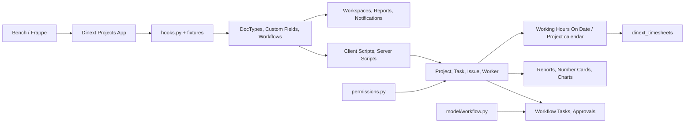

# Dinext Projects

## Обзор

**Dinext Projects** — приложение для платформы [Frappe](https://frappeframework.com/), расширяющее управление проектами, согласованиями и финансовым контролем. Оно не является самостоятельным продуктом: устанавливается в существующее окружение [Bench](https://github.com/frappe/bench) (Frappe/ERPNext) и добавляет модуль **Dinext Projects** с кастомными типами документов, рабочими процессами, отчётами, дашбордами и уведомлениями.

Учёт времени (таймшиты, заявки на отсутствие, связанные отчёты и workspace) вынесен в отдельное приложение **[dinext_timesheets](https://dinext.gitlab.yandexcloud.net/erpnext/dinext/dinext-timesheets)**. Это приложение публикует shared-контракт для timesheets: **Worker** (в т.ч. поле `wtimesheet_template`), **Working Hours On Date** и **Project.custom_working_hours_on_date**.

Значительная часть поведения задаётся экспортируемыми метаданными Frappe: DocType, Custom Field, Client Script, Server Script, Workflow, Report, Workspace, Notification. Тонкий слой Python используется для whitelisted API (проверка прав, получение переходов workflow).

---

## Возможности

### Shared-контракт для таймшитов

Эти объекты остаются в `dinext_projects` и потребляются `dinext_timesheets`:

- **Worker** — карточка исполнителя; поле `wtimesheet_template` ссылается на `Timesheet Template` из `dinext_timesheets`.
- **Working Hours On Date** — справочник сокращённых/особых рабочих дней.
- **Project.custom_working_hours_on_date** — связь проекта с календарём рабочих часов (используется, в том числе, серверным скриптом расчёта оценок Issue).

Роли согласования таймшитов (`Dinext_UTP_Appoval`, `Dinext_UT_Full_Access`) и DocType таймшитов принадлежат `dinext_timesheets`. Роль `Dinext_Worker` остаётся в projects.

### Согласования

- Workflow для согласования проектов, Expense Claim, Purchase Invoice, Sales Invoice (экспортируемые Workflow в fixtures).
- **Workflow Task** — задачи согласования с текущим/следующим состоянием, действием, назначенным пользователем и доступными переходами; создание/закрытие ToDo через Server Script.

### Проектное планирование и лимиты

- **Project** (стандартный DocType) расширен кастомными полями и дочерними таблицами: учёт, бизнес-сферы, портфель, контакты, утилизация, настройки по задачам/типам.
- **Project Work Efforts** и **Project Work Efforts Amount** — плановые трудозатраты по проекту, задаче, роли и периоду.
- **Limit Control** — пороги предупреждения/уведомления/блокировки.
- **Project Utilization Table** / **Worker Utilization Table** — плановая утилизация.

### Команды проекта, ставки и прибыльность

- **Project Team Details** — роли, участники, уровни затрат, категории ставок, периоды действия, флаги согласования и уведомлений по лимитам.
- **Cost Level**, **Rate Category**, **Rate Table** — справочники ставок и категорий.
- **Project Role**, **Project Contact List**, **Project Portfolio**, **Project Payment Scheme** — роли, контакты, портфель и схема оплаты проектов.
- Отчёты по контролю ставок (коммерческие и T&M проекты), дашборды «Выручка по клиентам», «Доходы и расходы».

### Отчёты и дашборды

- **Статус по всем ком. проектам**, **Контроль ставок по проектам**, **Контроль ставок по T&M проектам V2** — Query/Report Builder отчёты.
- Отчёты по таймшитам и утилизации живут в `dinext_timesheets`.
- **Workspace**: «Мои проекты», «Мои задачи», «Аналитика», «Фин. контроль», «DiLike» — рабочие пространства с number cards, графиками и быстрыми ссылками.
- **Dashboard Chart**: «Выручка по клиентам», «Доходы и расходы».

### Уведомления и автоматизации

- **Требуется согласование** / **Требуется исправление** — уведомления по workflow-задачам.
- Автозаполнение Issue по входящей коммуникации, создание Task из Meeting Notes, зеркалирование тегов Issue–Task и др. реализованы в Server Script (fixtures).

### Прочее

- **Meeting Notes** и **Assignments** — протоколы встреч с решениями и поручениями; автоматическое создание Task и ToDo из поручений (Server Script).
- **Projects Email Mapping**, **Setting Table** — маппинг писем на клиента/проект и настройки.
- **Issue Identification**, **Issue Estimations**, **Issue Participants**, **Project Issue Setting** — расширение работы с тикетами и настройками по проекту.
- **User Delegate** — делегирование пользователей.
- **Task Relation**, **Type Of Meeting**, **Business Area**, **Tax Id Code Type** и др. — вспомогательные справочники и связи.

---

## Архитектура

Поведение приложения формируется двумя слоями:

1. **Метаданные Frappe (fixtures и DocType)**  
   При установке и миграции приложение подтягивает из репозитория и синхронизирует с сайтом:
   - кастомные DocType и дочерние таблицы проектов;
   - Custom Field (в т.ч. расширение Project, включая `custom_working_hours_on_date`);
   - Client Script и Server Script модуля «Dinext Projects»;
   - Workflow для проектов и счетов;
   - роли projects (без `Dinext_UT_*`), Custom DocPerm (без parents таймшитов), Module Profile, Role Permission for Page and Report;
   - справочники проектов и shared `Working Hours On Date`;
   - Workspace, Number Card, Dashboard Chart, Notification.

2. **Минимальный Python-слой**  
   - `dinext_projects/dinext_projects/permissions.py` — whitelisted-методы `has_permission`, `get_doc_permissions`, `get_users_with_role`.
   - `dinext_projects/dinext_projects/model/workflow.py` — `get_transitions(doc, user, workflow)`.

Итого: основная бизнес-логика проектов сосредоточена в Server Script и Client Script в `dinext_projects/fixtures/`. Логика таймшитов — в `dinext_timesheets`.

---

## Установка

Приложение устанавливается в существующий Bench (с Frappe и при необходимости ERPNext).

1. Перейти в корень bench:
   ```bash
   cd /path/to/your/bench
   ```

2. Получить приложение (указать актуальный URL и ветку):
   ```bash
   bench get-app https://github.com/your-org/dinext_projects --branch develop
   ```
   Либо клонировать в `apps/dinext_projects` и подключить как локальное приложение.

3. Установить приложение на сайт:
   ```bash
   bench --site your-site.local install-app dinext_projects
   ```

4. Выполнить миграции при обновлении:
   ```bash
   bench --site your-site.local migrate
   ```

5. При необходимости пересобрать фронтенд:
   ```bash
   bench build --app dinext_projects
   ```

---

## Использование

После установки в Desk появляется модуль **Dinext Projects**. Основные точки входа:

- **Мои проекты** — список и дашборд проектов (по типам, статусам, клиентам), справочники и отчёты.
- **Мои задачи** — задачи пользователя.
- **Аналитика** — выручка, расходы, графики P&amp;L, выручка по клиентам.
- **Фин. контроль** — контроль ставок и финансовых показателей.

Учёт времени и workspace «Мои таймшиты» доступны после установки `dinext_timesheets`. Workflow-задачи проектов выполняются через стандартные формы Frappe с Client/Server Script и Workflow.

---

## Технологии

- **Backend:** Python 3.10+, Frappe Framework (управление метаданными, ORM, API, планировщик).
- **Frontend:** JavaScript в рамках Frappe Desk; клиентская логика в основном в Client Script (fixtures) и в JS-файлах отчётов (`report/*/*.js`).
- **Данные:** MariaDB/PostgreSQL (через Frappe).
- **Сборка и качество кода:** ruff, eslint, prettier, pre-commit.

---

## Конфигурация

- Конфигурация приложения задаётся в `dinext_projects/hooks.py` (в т.ч. список `fixtures`). Менять поведение установки без правки кода можно только в рамках возможностей Frappe (сайт, DocType, скрипты в UI).
- Переменные окружения и параметры сервера — стандартные для Bench/Frappe (см. документацию [Frappe](https://frappeframework.com/docs)).
- Роли и права экспортируются в fixtures: роли `Dinext_%` кроме timesheets-ролей; Custom DocPerm с исключением parents таймшитов. После изменения прав в системе — `bench export-fixtures` и коммит JSON.

---

## Требования

- [Bench](https://github.com/frappe/bench) с установленными Frappe (и при необходимости ERPNext).
- Python **>= 3.10** (указано в `pyproject.toml`).
- Соответствие версий Frappe/ERPNext, с которыми разрабатывалось приложение (уточняйте по репозиторию/релизам).
- Для разработки: Node.js и yarn для сборки фронтенда; pre-commit для проверок (см. раздел «Разработка и сопровождение»).

---

## Разработка и сопровождение

### Где находится логика

- **Метаданные и автоматизации:** основная логика — в DocType (JSON), Custom Field, Client Script, Server Script, Workflow, Report, Workspace, Notification. Они экспортируются в `dinext_projects/fixtures/` и при установке/миграции подтягиваются на сайт. Изменения в системе (через UI или API) нужно при необходимости экспортировать командой `bench export-fixtures` (см. AGENTS.md).
- **Python:** только обёртки прав и workflow (`permissions.py`, `model/workflow.py`), Script Report в `report/*/`, контекст уведомлений в `notification/*/*.py`. Контроллеры DocType создаются/расширяются только при явной необходимости (см. AGENTS.md).
- **Клиентский код:** в основном в Client Script (fixtures) и в JS-файлах отчётов в `dinext_projects/dinext_projects/report/`.

### Fixtures как основа приложения

Приложение в значительной степени **metadata-driven**: поведение форм, расчёты, согласования и отчёты задаются экспортируемыми объектами Frappe. Редактирование Client Script, Server Script, Custom Field, Workflow в системе без последующего экспорта фикстур приводит к расхождению репозитория и установленной инстанции. Рекомендуется после изменений таких объектов выполнять `bench export-fixtures` и коммитить обновлённые JSON (при этом список экспортируемых DocType в `hooks.py` должен соответствовать ожидаемому набору).

### Проверка кода (pre-commit)

В репозитории настроен [pre-commit](https://pre-commit.com/). Перед коммитами рекомендуется установить хуки:

```bash
cd apps/dinext_projects
pre-commit install
```

Используются:

- **ruff** — линтер и форматтер Python (в т.ч. сортировка импортов).
- **eslint** — проверка JavaScript (исключены папки с библиотеками и сборками).
- **prettier** — форматирование JS/Vue/SCSS.
- **pre-commit-hooks** — проверка пробелов, merge conflicts, AST, JSON/TOML/YAML, debug-выражений.

Конфигурация: `.pre-commit-config.yaml`, `.eslintrc`, `.editorconfig`; настройки ruff — в `pyproject.toml`.

### Документация для разработчиков

Подробное руководство по разработке в рамках Frappe (DocType, контроллеры, fixtures, миграции, тесты, MCP и т.д.) — в файле **[AGENTS.md](AGENTS.md)** в корне репозитория. Используйте его как основной инженерный гайд при доработке приложения.

---

## Участие в разработке

1. Форк или ветка репозитория, изменения в отдельной ветке.
2. Установка pre-commit и прохождение проверок (см. выше).
3. Соответствие стилю кода (ruff, eslint, prettier).
4. Для изменений в метаданных (скрипты, поля, workflow) — при необходимости экспорт фикстур и коммит обновлённых файлов.
5. Коммиты с осмысленными сообщениями; при необходимости — обновление раздела «Changelog» в README.

---

## Документация

- [Frappe Framework](https://frappeframework.com/docs) — общая документация платформы.
- [Bench](https://github.com/frappe/bench) — установка и управление окружением.
- **[AGENTS.md](AGENTS.md)** — внутренний гайд по разработке и сопровождению приложения (DocType, fixtures, миграции, тесты, лучшие практики).

---

## Благодарности

- [Frappe Technologies](https://frappe.io/) — платформа Frappe и экосистема.
- Dinext — издатель и поддержка приложения (info@dinext.ru).

---

## Changelog

Краткая сводка последних изменений по истории коммитов:

- **Split таймшитов:** учёт времени и отпусков перенесён в `dinext_timesheets`; в projects оставлен shared-контракт (`Worker`, `Working Hours On Date`, `Project.custom_working_hours_on_date`) и скорректированы правила экспорта fixtures.
- **Удаление устаревшего кода:** удалены deprecated файлы и конфигурации, связанные с бюджетом проектов, управлением рисками (категории, уровни, воздействия, стратегии, приоритеты, вероятности), назначением рабочей нагрузки, устаревшими Server Script и Client Script; упрощение структуры и улучшение сопровождаемости.
- **Дашборды и P&amp;L:** доработка дашборда задач по проектам (client_script), улучшение отображения графиков и элементов; добавлено выпадающее меню для действий P&amp;L в планировании проектов, правки стилей элементов бюджета.
- **Рефакторинг проектной части:** обновление JS/JSON для планирования проектов, кастомных полей и типов; улучшение UI отчётов по прибыли и убыткам; приведение имён и типов полей в соответствие с требованиями; удаление устаревших полей и скриптов.
- **Роли и права:** возврат роли Dinext_Support_Dispatcher, обновление custom fields и ролей в fixtures; настройка прав доступа к страницам и отчётам.
- **Метаданные и модули:** переименование модуля в конфигурации (Dinext Risk Management → Dinext Projects), правки видимости полей; обновление уведомлений (статус enabled, формат сообщений); правки workspace DiLike и ролей.
- **Очистка ресурсов:** удаление неиспользуемых изображений, тем, настроек навигации, CSS/JS (в т.ч. Gantt, ECharts, Frappe DataTable, HyperList) для уменьшения размера кодовой базы.

---

## Структура репозитория

```
dinext_projects/
├── dinext_projects/                 # Пакет приложения (Python-модуль)
│   ├── __init__.py                  # Версия приложения (__version__)
│   ├── hooks.py                     # Конфигурация приложения, список fixtures
│   ├── modules.txt                  # Имя модуля в Desk: "Dinext Projects"
│   ├── patches.txt                  # Патчи миграций (pre/post model sync)
│   ├── fixtures/                    # Экспорт метаданных Frappe (JSON)
│   │   ├── client_script.json
│   │   ├── server_script.json
│   │   ├── custom_field.json
│   │   ├── workflow.json
│   │   ├── role.json
│   │   ├── custom_docperm.json
│   │   ├── working_hours_on_date.json
│   │   └── ...
│   ├── dinext_projects/              # Модуль "Dinext Projects"
│   │   ├── permissions.py           # Whitelisted: has_permission, get_doc_permissions, get_users_with_role
│   │   ├── model/
│   │   │   └── workflow.py          # Whitelisted: get_transitions
│   │   ├── doctype/                  # Кастомные DocType (JSON + при необходимости .py/.js)
│   │   │   ├── worker/
│   │   │   ├── working_hours_on_date/
│   │   │   ├── workflow_task/
│   │   │   ├── project_team_details/
│   │   │   ├── project_work_efforts/
│   │   │   ├── meeting_notes/
│   │   │   └── ... (остальные DocType проектов)
│   │   ├── report/
│   │   ├── workspace/                # Мои проекты, Мои задачи, Аналитика, Фин. контроль, DiLike
│   │   ├── number_card/
│   │   ├── dashboard_chart/
│   │   ├── notification/
│   │   └── custom/
│   ├── public/
│   ├── templates/
│   └── translations/
│       └── ru.csv
├── pyproject.toml
├── README.md
└── AGENTS.md                        # stub → центральные инструкции в dinext-docs
```

Таймшитные DocType, отчёты, workspace «Мои таймшиты» и связанные уведомления находятся в приложении `dinext_timesheets`.

**Назначение ключевых каталогов:**

| Каталог / файл | Назначение |
|-----------------|------------|
| `dinext_projects/hooks.py` | Точка входа конфигурации приложения; список fixtures определяет, какие метаданные подтягиваются при установке/миграции. |
| `dinext_projects/fixtures/` | Экспортированные метаданные (Client/Server Script, Custom Field, Workflow, роли, справочники и т.д.). Источник истины для воспроизводимой установки. |
| `dinext_projects/dinext_projects/doctype/` | Определения кастомных DocType и дочерних таблиц. |
| `dinext_projects/dinext_projects/report/` | Определения отчётов; для Script Report — .py (колонки и данные) и .js (фильтры). |
| `dinext_projects/dinext_projects/workspace/` | Конфигурация рабочих пространств в Desk. |
| `dinext_projects/dinext_projects/number_card/`, `dashboard_chart/` | Виджеты дашбордов (KPI и графики). |
| `dinext_projects/dinext_projects/notification/` | ExampleCustomer08 уведомлений и Python-контекст для них. |
| `dinext_projects/dinext_projects/custom/` | Расширения стандартных DocType (например, project.json для Project). |
| `AGENTS.md` | Подробное руководство по разработке в рамках Frappe. |

---

## Схема взаимодействия компонентов



Упрощённо: Bench загружает приложение; `hooks.py` задаёт набор fixtures. Метаданные формируют структуру данных и сценарии согласований для Project/Task/Issue. Shared-объекты Worker и Working Hours On Date потребляются `dinext_timesheets`. Тонкие Python-модули `permissions.py` и `model/workflow.py` предоставляют API для проверки прав и переходов workflow.

---

## Лицензия

MIT. См. [license.txt](license.txt).
