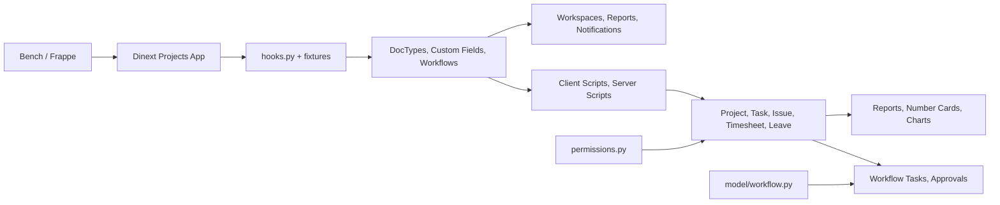

# Dinext Projects

## Обзор

**Dinext Projects** — это приложение для платформы [Frappe](https://frappeframework.com/), расширяющее возможности управления проектами, учётом времени, согласованиями и финансовым контролем. Оно не является самостоятельным продуктом: приложение устанавливается в существующее окружение [Bench](https://github.com/frappe/bench) (Frappe/ERPNext) и добавляет модуль **Dinext Projects** с кастомными типами документов, рабочими процессами, отчётами, дашбордами и уведомлениями.

Значительная часть поведения системы задаётся не классическим Python-кодом, а экспортируемыми метаданными Frappe: DocType, Custom Field, Client Script, Server Script, Workflow, Report, Workspace, Notification. Тонкий слой Python используется для whitelisted API (проверка прав, получение переходов workflow) и для части отчётов (Script Report).

---

## Возможности

### Таймшиты и утилизация

- **User Timesheet** и **User Timesheet Position** — учёт времени по проектам, задачам (Task/Issue), ролям и датам с полями: запланированные/фактические/утилизационные часы, отпуск, нормализация, отчётный период.
- **User Timesheet Position Details** — детализация по датам и часам внутри позиции таймшита.
- Расчёт итогов, графика, отпусков, плана утилизации и нормализации выполняется серверными скриптами (fixtures).
- **Worker**, **Timesheet Template**, **Working Hours On Date**, **Worker Level**, **Worker Utilization Table** — справочники и шаблоны для расчёта утилизации и рабочих часов.

### Отпуска и согласования

- **Application For Leave** — заявки на отсутствие с привязкой к Worker, типу отпуска, проектам, части дня; расчёт часов с учётом Holiday List и шаблона таймшита (серверные скрипты).
- Workflow для согласования заявок на отпуск, таймшитов, проектов, Expense Claim, Purchase Invoice, Sales Invoice (экспортируемые Workflow в fixtures).
- **Workflow Task** — задачи согласования с текущим/следующим состоянием, действием, назначенным пользователем и доступными переходами; создание/закрытие ToDo через Server Script.

### Проектное планирование и лимиты

- **Project** (стандартный DocType) расширен большим набором кастомных полей и дочерних таблиц: учёт, бизнес-сферы, портфель, риски, контакты, утилизация, настройки по задачам/типам (см. `dinext_projects/dinext_projects/custom/project.json`).
- **Project Work Efforts** и **Project Work Efforts Amount** — плановые трудозатраты по проекту, задаче, роли и периоду.
- **Limit Control** — пороги предупреждения/уведомления/блокировки; проверка лимитов по задачам реализована в Server Script.
- **Project Utilization Table** — плановая утилизация по проекту.

### Команды проекта, ставки и прибыльность

- **Project Team Details** — роли, участники, уровни затрат, категории ставок, периоды действия, флаги согласования и уведомлений по лимитам.
- **Cost Level**, **Rate Category**, **Rate Table** — справочники ставок и категорий.
- **Project Role**, **Project Contact List**, **Project Portfolio**, **Project Payment Scheme** — роли, контакты, портфель и схема оплаты проектов.
- Отчёты по контролю ставок (коммерческие и T&M проекты), дашборды «Выручка по клиентам», «Доходы и расходы».

### Отчёты и дашборды

- **Отчёт по ТШ** (Script Report) — детализация таймшитов по пользователю, группе, проекту, роли, задаче, дате и часам (фильтры: проект, пользователь, функциональная группа, период).
- **Отчёт для подрядчиков** (Script Report) — отчётность по подрядчикам.
- **Отчёт по утилизации**, **Статус по всем ком. проектам**, **Статистика по ТШ**, **Контроль ставок по проектам**, **Контроль ставок по T&M проектам V2** — Query/Report Builder отчёты.
- **Workspace**: «Мои проекты», «Мои задачи», «Мои таймшиты», «Аналитика», «Фин. контроль», «Моя доска», «DiLike» — рабочие пространства с number cards, графиками и быстрыми ссылками.
- **Number Card** (22 карточки): просроченные задачи, заявки/таймшиты на согласовании/согласованные/отклонённые, баллы, задачи без сроков/ответственных и др.
- **Dashboard Chart**: «Выручка по клиентам», «Доходы и расходы».

### Уведомления и автоматизации

- **Таймшит не отправлен** — напоминание о неподанном таймшите.
- **Требуется согласование** / **Согласование ТШ** — уведомления о таймшитах на согласовании.
- **Требуется исправление** — уведомление о необходимости правок.
- **Лимит по задаче** — уведомление о превышении лимита по задаче.
- Контекст уведомлений задаётся Python-файлами в соответствующих папках `notification/`.
- Автозаполнение Issue по входящей коммуникации, создание Task из Meeting Notes, зеркалирование тегов Issue–Task и др. реализованы в Server Script (fixtures).

### Прочее

- **Meeting Notes** и **Assignments** — протоколы встреч с решениями и поручениями; автоматическое создание Task и ToDo из поручений (Server Script).
- **Projects Email Mapping**, **Setting Table** — маппинг писем на клиента/проект и настройки.
- **Issue Identification**, **Issue Estimations**, **Issue Participants**, **Project Issue Setting** — расширение работы с тикетами и настройками по проекту.
- **User Delegate**, **User Projects** — делегирование и привязка пользователей к проектам.
- **Doctype For Timesheet**, **Task Relation**, **Type Of Meeting**, **Business Area**, **Tax Id Code Type** и др. — вспомогательные справочники и связи.

---

## Архитектура

Поведение приложения формируется двумя слоями:

1. **Метаданные Frappe (fixtures и DocType)**  
   При установке и миграции приложение подтягивает из репозитория и синхронизирует с сайтом:
   - кастомные DocType и дочерние таблицы;
   - Custom Field (в т.ч. массивное расширение Project);
   - Client Script и Server Script (модуль «Dinext Projects»);
   - Workflow для заявок на отпуск, таймшитов, проектов, счетов;
   - роли, права (Custom DocPerm), Module Profile, Role Permission for Page and Report;
   - справочники (Issue Priority, Project Payment Scheme, Project Type, Type Of Leave, Holiday List, Timesheet Template, Working Hours On Date и др.);
   - Workspace, Number Card, Dashboard Chart, Notification, Web Page.

2. **Минимальный Python-слой**  
   - `dinext_projects/dinext_projects/permissions.py` — whitelisted-методы `has_permission`, `get_doc_permissions`, `get_users_with_role` (обёртки над стандартным API Frappe с возможностью проверки прав от имени другого пользователя).
   - `dinext_projects/dinext_projects/model/workflow.py` — `get_transitions(doc, user, workflow)` для получения доступных переходов workflow от имени указанного пользователя.
   - Script Report: `report/отчет_по_тш/отчет_по_тш.py`, `report/отчет_для_подрядчиков/отчет_для_подрядчиков.py` — колонки, SQL-запросы и фильтры.
   - Notification: Python-файлы в `notification/*/` для контекста шаблонов.

Итого: основная бизнес-логика (расчёты часов, лимиты, согласования, автозаполнение, создание задач) сосредоточена в Server Script и Client Script, экспортируемых в `dinext_projects/fixtures/`. Репозиторий не содержит отдельного `api.py`; публичный API ограничен указанными whitelisted-методами.

---

## Установка

Приложение устанавливается в существующий Bench (с Frappe и при необходимости ERPNext).

1. Перейти в корень bench:
   ```bash
   cd /path/to/your/bench
   ```

2. Получить приложение (указать актуальный URL и ветку):
   ```bash
   bench get-app https://github.com/your-org/dinext_projects --branch develop
   ```
   Либо клонировать в `apps/dinext_projects` и подключить как локальное приложение.

3. Установить приложение на сайт:
   ```bash
   bench --site your-site.local install-app dinext_projects
   ```

4. Выполнить миграции при обновлении:
   ```bash
   bench --site your-site.local migrate
   ```

5. При необходимости пересобрать фронтенд:
   ```bash
   bench build --app dinext_projects
   ```

---

## Использование

После установки в Desk появляется модуль **Dinext Projects**. Основные точки входа:

- **Мои проекты** — список и дашборд проектов (по типам, статусам, клиентам), справочники и отчёты.
- **Мои задачи** — задачи пользователя.
- **Мои таймшиты** — учёт времени, отправка на согласование.
- **Аналитика** — выручка, расходы, графики P&amp;L, выручка по клиентам.
- **Фин. контроль** — контроль ставок и финансовых показателей.

Создание и согласование таймшитов, заявок на отпуск и workflow-задач выполняется через стандартные формы Frappe с подключёнными Client/Server Script и Workflow. Отчёты доступны через «Отчёты» и через ссылки в workspace.

---

## Технологии

- **Backend:** Python 3.10+, Frappe Framework (управление метаданными, ORM, API, планировщик).
- **Frontend:** JavaScript в рамках Frappe Desk; клиентская логика в основном в Client Script (fixtures) и в JS-файлах отчётов (`report/*/*.js`).
- **Данные:** MariaDB/PostgreSQL (через Frappe).
- **Сборка и качество кода:** ruff, eslint, prettier, pre-commit.

---

## Конфигурация

- Конфигурация приложения задаётся в `dinext_projects/hooks.py` (в т.ч. список `fixtures`). Менять поведение установки без правки кода можно только в рамках возможностей Frappe (сайт, DocType, скрипты в UI).
- Переменные окружения и параметры сервера — стандартные для Bench/Frappe (см. документацию [Frappe](https://frappeframework.com/docs)).
- Роли и права экспортируются в fixtures (роли с именем, содержащим «Dinext»; Custom DocPerm, Module Profile, Role Permission for Page and Report). После изменения прав в системе рекомендуется выполнить `bench export-fixtures` и закоммитить обновлённые JSON (см. AGENTS.md).

---

## Требования

- [Bench](https://github.com/frappe/bench) с установленными Frappe (и при необходимости ERPNext).
- Python **>= 3.10** (указано в `pyproject.toml`).
- Соответствие версий Frappe/ERPNext, с которыми разрабатывалось приложение (уточняйте по репозиторию/релизам).
- Для разработки: Node.js и yarn для сборки фронтенда; pre-commit для проверок (см. раздел «Разработка и сопровождение»).

---

## Разработка и сопровождение

### Где находится логика

- **Метаданные и автоматизации:** основная логика — в DocType (JSON), Custom Field, Client Script, Server Script, Workflow, Report, Workspace, Notification. Они экспортируются в `dinext_projects/fixtures/` и при установке/миграции подтягиваются на сайт. Изменения в системе (через UI или API) нужно при необходимости экспортировать командой `bench export-fixtures` (см. AGENTS.md).
- **Python:** только обёртки прав и workflow (`permissions.py`, `model/workflow.py`), Script Report в `report/*/`, контекст уведомлений в `notification/*/*.py`. Контроллеры DocType создаются/расширяются только при явной необходимости (см. AGENTS.md).
- **Клиентский код:** в основном в Client Script (fixtures) и в JS-файлах отчётов в `dinext_projects/dinext_projects/report/`.

### Fixtures как основа приложения

Приложение в значительной степени **metadata-driven**: поведение форм, расчёты, согласования и отчёты задаются экспортируемыми объектами Frappe. Редактирование Client Script, Server Script, Custom Field, Workflow в системе без последующего экспорта фикстур приводит к расхождению репозитория и установленной инстанции. Рекомендуется после изменений таких объектов выполнять `bench export-fixtures` и коммитить обновлённые JSON (при этом список экспортируемых DocType в `hooks.py` должен соответствовать ожидаемому набору).

### Проверка кода (pre-commit)

В репозитории настроен [pre-commit](https://pre-commit.com/). Перед коммитами рекомендуется установить хуки:

```bash
cd apps/dinext_projects
pre-commit install
```

Используются:

- **ruff** — линтер и форматтер Python (в т.ч. сортировка импортов).
- **eslint** — проверка JavaScript (исключены папки с библиотеками и сборками).
- **prettier** — форматирование JS/Vue/SCSS.
- **pre-commit-hooks** — проверка пробелов, merge conflicts, AST, JSON/TOML/YAML, debug-выражений.

Конфигурация: `.pre-commit-config.yaml`, `.eslintrc`, `.editorconfig`; настройки ruff — в `pyproject.toml`.

### Документация для разработчиков

Подробное руководство по разработке в рамках Frappe (DocType, контроллеры, fixtures, миграции, тесты, MCP и т.д.) — в файле **[AGENTS.md](AGENTS.md)** в корне репозитория. Используйте его как основной инженерный гайд при доработке приложения.

---

## Участие в разработке

1. Форк или ветка репозитория, изменения в отдельной ветке.
2. Установка pre-commit и прохождение проверок (см. выше).
3. Соответствие стилю кода (ruff, eslint, prettier).
4. Для изменений в метаданных (скрипты, поля, workflow) — при необходимости экспорт фикстур и коммит обновлённых файлов.
5. Коммиты с осмысленными сообщениями; при необходимости — обновление раздела «Changelog» в README.

---

## Документация

- [Frappe Framework](https://frappeframework.com/docs) — общая документация платформы.
- [Bench](https://github.com/frappe/bench) — установка и управление окружением.
- **[AGENTS.md](AGENTS.md)** — внутренний гайд по разработке и сопровождению приложения (DocType, fixtures, миграции, тесты, лучшие практики).

---

## Благодарности

- [Frappe Technologies](https://frappe.io/) — платформа Frappe и экосистема.
- Dinext — издатель и поддержка приложения (info@dinext.ru).

---

## Changelog

Краткая сводка последних изменений по истории коммитов:

- **Удаление устаревшего кода:** удалены deprecated файлы и конфигурации, связанные с бюджетом проектов, управлением рисками (категории, уровни, воздействия, стратегии, приоритеты, вероятности), назначением рабочей нагрузки, устаревшими Server Script и Client Script; упрощение структуры и улучшение сопровождаемости.
- **Дашборды и P&amp;L:** доработка дашборда задач по проектам (client_script), улучшение отображения графиков и элементов; добавлено выпадающее меню для действий P&amp;L в планировании проектов, правки стилей элементов бюджета.
- **Рефакторинг проектной части:** обновление JS/JSON для планирования проектов, кастомных полей и типов; улучшение UI отчётов по прибыли и убыткам; приведение имён и типов полей в соответствие с требованиями; удаление устаревших полей и скриптов.
- **Роли и права:** возврат роли Dinext_Support_Dispatcher, обновление custom fields и ролей в fixtures; настройка прав доступа к страницам и отчётам.
- **Метаданные и модули:** переименование модуля в конфигурации (Dinext Risk Management → Dinext Projects), правки видимости полей; обновление уведомлений (статус enabled, формат сообщений); правки workspace DiLike и ролей.
- **Очистка ресурсов:** удаление неиспользуемых изображений, тем, настроек навигации, CSS/JS (в т.ч. Gantt, ECharts, Frappe DataTable, HyperList) для уменьшения размера кодовой базы.

---

## Структура репозитория

```
dinext_projects/
├── dinext_projects/                 # Пакет приложения (Python-модуль)
│   ├── __init__.py                  # Версия приложения (__version__)
│   ├── hooks.py                     # Конфигурация приложения, список fixtures
│   ├── modules.txt                  # Имя модуля в Desk: "Dinext Projects"
│   ├── patches.txt                  # Патчи миграций (pre/post model sync)
│   ├── fixtures/                    # Экспорт метаданных Frappe (JSON)
│   │   ├── client_script.json
│   │   ├── server_script.json
│   │   ├── custom_field.json
│   │   ├── workflow.json
│   │   ├── role.json
│   │   ├── custom_docperm.json
│   │   ├── module_profile.json
│   │   ├── web_page.json
│   │   ├── workflow_state.json
│   │   ├── workflow_action_master.json
│   │   ├── holiday_list.json
│   │   ├── timesheet_template.json
│   │   ├── working_hours_on_date.json
│   │   ├── issue_priority.json
│   │   ├── issue_type.json
│   │   ├── task_type.json
│   │   ├── project_type.json
│   │   ├── project_payment_scheme.json
│   │   ├── type_of_leave.json
│   │   ├── issue_identification_type.json
│   │   ├── role_profile.json
│   │   ├── calendar_view.json
│   │   ├── custom_html_block.json
│   │   ├── kanban_board.json
│   │   └── ...
│   ├── dinext_projects/              # Модуль "Dinext Projects"
│   │   ├── permissions.py           # Whitelisted: has_permission, get_doc_permissions, get_users_with_role
│   │   ├── model/
│   │   │   └── workflow.py          # Whitelisted: get_transitions
│   │   ├── doctype/                  # Кастомные DocType (JSON + при необходимости .py/.js)
│   │   │   ├── user_timesheet/
│   │   │   ├── user_timesheet_position/
│   │   │   ├── user_timesheet_position_details/
│   │   │   ├── worker/
│   │   │   ├── application_for_leave/
│   │   │   ├── workflow_task/
│   │   │   ├── project_team_details/
│   │   │   ├── project_work_efforts/
│   │   │   ├── project_work_efforts_amount/
│   │   │   ├── limit_control/
│   │   │   ├── meeting_notes/
│   │   │   ├── assignments/
│   │   │   ├── rate_table/
│   │   │   ├── rate_category/
│   │   │   ├── cost_level/
│   │   │   ├── timesheet_template/
│   │   │   ├── working_hours_on_date/
│   │   │   ├── worker_level/
│   │   │   ├── worker_utilization_table/
│   │   │   └── ... (остальные DocType)
│   │   ├── report/                   # Отчёты (Script Report и Query Report)
│   │   │   ├── отчет_по_тш/         # Script Report: детализация таймшитов
│   │   │   ├── отчет_для_подрядчиков/
│   │   │   ├── отчет_по_утилизации/
│   │   │   ├── статус_по_всем_ком.проектам/
│   │   │   ├── статистика_по_тш/
│   │   │   ├── контроль_ставок_по_проектам/
│   │   │   ├── контроль_ставок_по_t&m_проектам_v2/
│   │   │   └── ...
│   │   ├── workspace/                # Рабочие пространства Desk
│   │   │   ├── мои_проекты/
│   │   │   ├── мои_задачи/
│   │   │   ├── мои_таймшиты/
│   │   │   ├── аналитика/
│   │   │   ├── фин._контроль/
│   │   │   ├── моя_доска/
│   │   │   └── dilike/
│   │   ├── number_card/              # Карточки KPI для дашбордов (22 карточки)
│   │   ├── dashboard_chart/          # Графики: выручка по клиентам, доходы и расходы
│   │   ├── notification/             # Шаблоны уведомлений (таймшиты, согласования, лимиты)
│   │   │   ├── таймшит_не_отправлен/
│   │   │   ├── требуется_согласование/
│   │   │   ├── согласоанияе_тш/
│   │   │   ├── требуется_исправление/
│   │   │   └── лимит_по_задаче/
│   │   └── custom/                   # Расширения стандартных DocType
│   │       └── project.json         # Массив кастомных полей и таблиц для Project
│   ├── public/                      # Статические ресурсы (при необходимости)
│   ├── templates/
│   └── translations/
│       └── ru.csv
├── pyproject.toml                   # Метаданные пакета, ruff, зависимости
├── .pre-commit-config.yaml          # Pre-commit: ruff, eslint, prettier, hooks
├── .eslintrc
├── .editorconfig
├── .gitignore
├── license.txt                      # MIT
├── README.md                        # Этот файл
├── AGENTS.md                        # Руководство по разработке для агентов и разработчиков
└── .cursor/                         # Настройки и навыки Cursor (не часть продукта)
    └── skills/
```

**Назначение ключевых каталогов:**

| Каталог / файл | Назначение |
|-----------------|------------|
| `dinext_projects/hooks.py` | Точка входа конфигурации приложения; список fixtures определяет, какие метаданные подтягиваются при установке/миграции. |
| `dinext_projects/fixtures/` | Экспортированные метаданные (Client/Server Script, Custom Field, Workflow, роли, справочники и т.д.). Источник истины для воспроизводимой установки. |
| `dinext_projects/dinext_projects/doctype/` | Определения кастомных DocType и дочерних таблиц. |
| `dinext_projects/dinext_projects/report/` | Определения отчётов; для Script Report — .py (колонки и данные) и .js (фильтры). |
| `dinext_projects/dinext_projects/workspace/` | Конфигурация рабочих пространств в Desk. |
| `dinext_projects/dinext_projects/number_card/`, `dashboard_chart/` | Виджеты дашбордов (KPI и графики). |
| `dinext_projects/dinext_projects/notification/` | Шаблоны уведомлений и Python-контекст для них. |
| `dinext_projects/dinext_projects/custom/` | Расширения стандартных DocType (например, project.json для Project). |
| `AGENTS.md` | Подробное руководство по разработке в рамках Frappe. |

---

## Схема взаимодействия компонентов



Упрощённо: Bench загружает приложение; `hooks.py` задаёт набор fixtures. Метаданные (DocType, поля, workflow) формируют структуру данных и сценарии согласований. Client Script и Server Script реализуют расчёты и автоматизации поверх документов Project, Task, Issue, таймшитов и заявок на отпуск. Отчёты и дашборды потребляют эти данные. Тонкие Python-модули `permissions.py` и `model/workflow.py` предоставляют API для проверки прав и переходов workflow.

---

## Лицензия

MIT. См. [license.txt](license.txt).
