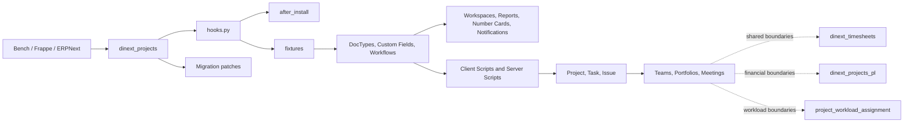

[Русский](README.ru.md)

# Dinext Projects

`dinext_projects` is a Frappe application for project management in the Dinext ecosystem.
It is installed into an existing [Bench](https://github.com/frappe/bench)
with Frappe and ERPNext and adds the **Dinext Projects** module: project teams,
roles, portfolios, meetings, Project/Task/Issue extensions, project workflows,
Desk workspaces, reports and notifications.

The application is metadata-driven: most behavior is stored in
exported Frappe fixtures (DocType, Custom Field, Client Script, Server
Script, Workflow and other metadata). Python code is used for
DocType controllers, installation and migration patches.

## Contents

- [Overview and responsibilities](#-overview-and-responsibilities)
- [Features](#-features)
- [Installation](#-installation)
- [Usage](#-usage)
- [Technologies](#-technologies)
- [Configuration and fixtures](#-configuration-and-fixtures)
- [Requirements](#-requirements)
- [Development and maintenance](#-development-and-maintenance)
- [Documentation](#-documentation)
- [Changelog](#-changelog)
- [Repository structure](#-repository-structure)
- [Interaction diagram](#-interaction-diagram)
- [License](#-license)

## 📖 Overview and responsibilities

The application retains the project management domain: project team membership, roles and portfolios,
Meeting Notes and Assignments, Project/Task/Issue extensions, project workflows
and related Desk analytics.

Functionality is divided among applications in the Dinext ecosystem:

| Application | Responsibility |
| --- | --- |
| `dinext_projects` | Project Team, Project Role, contacts and portfolios, meetings, PM extensions for Project/Task/Issue, Project workflow, the `Dinext_Worker` role. |
| `dinext_timesheets` | Time tracking: `Worker`, `Working Hours On Date`, UT/AFL, `Project.custom_working_hours_on_date`, the My Timesheets workspace and `Dinext_UT*` roles. |
| `dinext_projects_pl` | Rates, cost centers, payment schemes, P&L, Project/Task financial fields, the `Dinext_Financier`, `Dinext_Fin_Dir`, `Dinext_Budget_Approver` roles, Financial Control and Analytics workspaces, the Commercial Projects Number Card and rate-control reports. |
| `project_workload_assignment` | Planned work effort, `Project Work Efforts*`, `Limit Control`, utilization tables, and related UI and reports. |
| `dinext_deputies` | Owns DocType Permission for `User Delegate`. |

`hooks.py` declares the required applications `dinext_common`,
`doctype_permission` and `erpnext`. Earlier operational documentation
specified the following installation order for the full project domain:
`dinext_projects` → `dinext_projects_pl` → `doctype_permission` →
`dinext_timesheets` → `project_workload_assignment`. Before installing on a new
site, check this order against the versions and dependencies of the actual environment.

## ✨ Features

### Projects, teams and reference data

- Extensions to standard Project, Task and Issue through exported Custom Field,
  Client Script, Server Script and Property Setter records.
- **Project Team Details**: project roles, participants, effective periods, approval
  and notification flags.
- **Project Role**, **Project Contact List** and **Project Portfolio** — roles,
  contacts and the project portfolio.
- **Meeting Notes** and **Assignments** — meeting minutes, decisions and action items;
  automatic Task and ToDo creation is configured through Server Script.
- **Projects Email Mapping** and **Setting Table** — mapping incoming
  communications to a customer and project, plus settings.
- **Issue Identification**, **Issue Estimations**, **Issue Participants**,
  **Project Issue Setting**, **Task Relation**, **Type Of Meeting**,
  **Business Area**, **Tax Id Code Type** and other supporting entities.

### Approvals and automation

- Project workflow and related Workflow State / Workflow Action Master records
  are exported by this application.
- **Workflow Task** describes approval tasks: current and next
  states, action, assigned user and available transitions.
- **Approval Required** and **Correction Required** notifications.
- Populating Issue from incoming communications, creating Task from Meeting Notes,
  mirroring Issue–Task tags and other workflows are configured by Server Script in
  fixtures.

Workflows for Expense Claim, Purchase Invoice and Sales Invoice, and permissions
for Sales Invoice, Purchase Invoice and GL Entry belong to
`dinext_projects_pl`, rather than this application.

### Workspaces, reports and widgets

- Workspaces: **My Projects**, **My Tasks** and **DiLike**.
- The **Status of All Commercial Projects** Report Builder report.
- 35 Number Cards for project, task, Issue, approval and DiLike statuses.
- Two ToDo Notifications exist in the module JSON but are currently
  disabled (`enabled: 0`).
- Workspaces, the report, Number Cards and Notifications are supplied as module JSON;
  they are not included in the `fixtures` list in `hooks.py`.
- There are no local Dashboard Chart definitions in the repository.
- The **Analytics** workspace, **Commercial Projects** Number Card, financial
  charts/cards and rate-control reports are in `dinext_projects_pl`;
  timesheet and utilization reports are in `dinext_timesheets` and
  `project_workload_assignment`.

### Integrations with related domains

The `pt_worker`, `pt_cost_level` and `pt_category` fields on `Project Team Details`
are deliberately owned by related applications: respectively,
`dinext_timesheets` and `dinext_projects_pl`. This application's migration patch
relinquishes ownership of these fields without deleting the database columns. When
`dinext_timesheets` is present, the interface can use `pt_worker` as the primary
participant selection and synchronize `Worker.wuser` with `pt_participant`.

## 🚀 Installation

The application is installed into an existing Bench with Frappe and usually
ERPNext. Use the actual Git URL and branch of your distribution.

```bash
cd /path/to/your/bench
bench get-app <git-url> --branch <branch>
bench --site your-site.local install-app dinext_projects
bench --site your-site.local migrate
```

After changes to JavaScript, CSS or metadata affecting Desk, rebuild
assets and clear the cache if necessary:

```bash
bench build --app dinext_projects
bench --site your-site.local clear-cache
```

For local development, the application can be cloned into
`apps/dinext_projects` and connected as a local app.

## 🛠️ Usage

After installation, the **Dinext Projects** module is available in Desk.

- **My Projects** — projects by type, status and customer, reference data and reports.
- **My Tasks** — the current user's tasks.
- The **Analytics** workspace (nested under My Projects) appears after
  installing `dinext_projects_pl`.
- Workflow tasks are performed in standard Frappe forms through workflows and
  Client/Server Script.
- Time tracking and the **My Timesheets** workspace appear after installing
  `dinext_timesheets`.

## 📦 Technologies

- **Backend:** Python 3.10+, Frappe Framework and ERPNext.
- **Frontend:** Frappe Desk, JavaScript in Client Scripts and report files.
- **Data:** MariaDB or PostgreSQL through the Frappe ORM.
- **Package build:** `flit_core`.
- **Code quality:** pre-commit, ruff, Prettier and ESLint.

## 🔧 Configuration and fixtures

The main configuration is in `dinext_projects/hooks.py`.

- `fixtures` export Role Profile, Project Type, Issue Priority, Custom
  HTML Block, Issue Type, Task Type, Custom Field, Property Setter, Client
  Script, Server Script, Web Page, roles, Custom DocPerm, Project workflow,
  Workflow State, Workflow Action Master and some DocType Permission records.
- Module JSON under `dinext_projects/dinext_projects/` supplies custom DocTypes,
  workspaces, the Report Builder report, Number Cards and Notifications separately from
  fixture export.
- `after_install` clears the standard ERPNext Project Type and Issue
  Priority values before importing the application's values.
- Required apps: `dinext_common`, `doctype_permission`, `erpnext`.
- Global JS/CSS, scheduler events, doc events and overrides are not enabled
  at app level: the corresponding examples in `hooks.py` are commented out.
- Environment variables and server parameters use the standard
  Bench/Frappe mechanism; this repository declares no environment variables of its own.

After changing Frappe-managed objects (for example, Custom Field, Client
Script, Server Script or Workflow), export fixtures from Bench and include
the updated JSON in the commit:

```bash
bench --site your-site.local export-fixtures
```

UI changes without a subsequent fixture export create a discrepancy between
the site and the repository.

## ✅ Requirements

- [Bench](https://github.com/frappe/bench) with Frappe and ERPNext.
- Python **>= 3.10** (declared in `pyproject.toml`).
- Frappe/ERPNext versions compatible with your Dinext distribution.
- For JS/CSS development: the Node.js and yarn versions used by your Bench.
- For local checks: pre-commit.

## 🤝 Development and maintenance

### Workflow

1. Create a separate branch.
2. For any change, first follow the mandatory OpenSpec lifecycle in
   [AGENTS.md](AGENTS.md).
3. Make code and metadata changes only in accordance with the change's ready
   change.
4. Export fixtures when changing metadata.
5. Run checks and update the README when its factual content
   changes.

### Local checks

```bash
cd apps/dinext_projects
pre-commit install
pre-commit run --all-files
```

The configured hooks check Python (`ruff` and formatting), JavaScript
(`eslint`), JavaScript/Vue/SCSS (`prettier`), plus whitespace, merge conflict
markers, AST, JSON, TOML, YAML and debug statements.

### Where to find logic

- `fixtures/` — most behavior and exported metadata.
- `dinext_projects/doctype/` — custom DocType JSON definitions and controllers.
- `dinext_projects/report/` — currently the single Report Builder JSON
  Status of All Commercial Projects; a Script Report, if added, will contain
  Python for columns/data and JavaScript for filters.
- `dinext_projects/workspace/` — Desk workspace configuration.
- `dinext_projects/number_card/` — KPI cards; there are no local
  Dashboard Chart definitions.
- `dinext_projects/notification/` — notification ExampleCustomer08 and their Python context;
  the current two Notifications are disabled.
- `install.py` — the `after_install` handler.
- `patches/` — migration patches.

The README does not replace the engineering contract: the navigation stub
[AGENTS.md](AGENTS.md) points to the canonical Frappe and Dinext rules.

## 📄 Documentation

- [AGENTS.md](AGENTS.md) — entry point for central Dinext guidance and the mandatory
  OpenSpec workflow.
- [Frappe Framework](https://frappeframework.com/docs) — platform documentation.
- [Bench](https://github.com/frappe/bench) — installation and environment management.

## 📝 Changelog

A brief historical summary from the commit history:

- Domains were separated: timesheets into `dinext_timesheets`, finance into
  `dinext_projects_pl`, work effort and utilization into
  `project_workload_assignment`; `dinext_projects` retains PM functionality and
  adjusted fixture filters.
- Removed obsolete files and configurations related to project budgeting,
  risk management (categories, levels, impacts, strategies, priorities and
  probabilities), workload assignment, and obsolete Server Script
  and Client Script records.
- Refined task dashboards, Project planning UI, P&L reports and budget element
  styles; added a dropdown menu for P&L actions.
- Updated roles and permissions, including restoring `Dinext_Support_Dispatcher`,
  Custom Fields, fixtures, notifications, the DiLike workspace and module metadata;
  changed field visibility and the module name (Dinext Risk Management → Dinext
  Projects).
- Removed unused images, themes, navigation settings, CSS and
  JS libraries (including Gantt, ECharts, Frappe DataTable and HyperList).

For the full log, consult the Git history of the specific branch.

## 🗂️ Repository structure

```text
dinext_projects/
├── AGENTS.md                         # Agent instructions
├── README.md                         # This document
├── license.txt                       # GPL-3 license
├── pyproject.toml                    # Package metadata, Python and ruff
├── .pre-commit-config.yaml           # Local checks
├── openspec/config.yaml              # OpenSpec configuration
└── dinext_projects/
    ├── __init__.py                   # Application version
    ├── hooks.py                      # App configuration, dependencies and fixtures
    ├── install.py                    # after_install hook
    ├── modules.txt                   # Desk module name
    ├── patches.txt                   # Migration patch list
    ├── patches/                      # Migration implementations
    ├── fixtures/                     # Exported Frappe metadata (JSON)
    ├── translations/ru.csv           # Russian translations
    ├── public/                       # Application public assets
    ├── templates/                    # Frappe templates
    └── dinext_projects/
        ├── doctype/                  # Custom DocType: JSON, controllers, tests, JS
        ├── report/                   # Frappe reports
        ├── workspace/                # My Projects, My Tasks, DiLike
        ├── number_card/              # PM/Issue/DiLike KPI cards
        └── notification/             # Notifications and Python context
```

Related applications provide timesheet DocTypes and the My Timesheets
workspace, financial P&L objects and workload planning; these are not included
in this tree.

## 🔗 Interaction diagram



Bench loads `hooks.py`; fixtures form the Frappe metadata and Desk workflows,
while `after_install` and migration patches maintain the site's correct state.
Related domains remain in separate applications and integrate through
agreed Frappe entities.

## 📜 License

[GNU GPL v3](license.txt).
