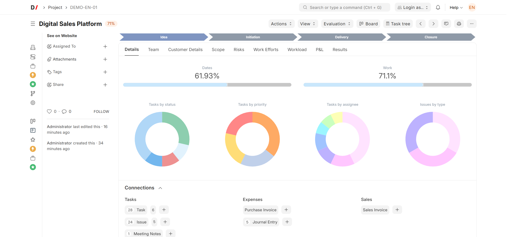
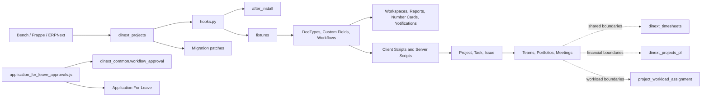

[Русский](README.ru.md)

<!-- dinext-presentation:start -->
<p align="center">
  <a href="https://dinext.ru"></a>
</p>
<h1 align="center">Dinext Projects</h1>

<hr>

<p align="center">Manage projects, teams, portfolios, tasks and issues in a shared Dinext workspace.</p>

<p align="center">
  
</p>
<p align="center"><sub>Project progress and work overview on demonstration data.</sub></p>

<p align="center">
  <a href="https://dinext.ru">Website</a> · <a href="https://docs.dinext.ru">Documentation</a>
</p>
<!-- dinext-presentation:end -->

# Dinext Projects

`dinext_projects` is a Frappe application for project management in the Dinext ecosystem.
It is installed into an existing [Bench](https://github.com/frappe/bench)
with Frappe and ERPNext and adds the **Dinext Projects** module: project teams,
roles, portfolios, meetings, Project/Task/Issue extensions, project workflows,
Desk workspaces, reports and notifications.

The application is metadata-driven: most behavior is stored in
exported Frappe fixtures (DocType, Custom Field, Client Script, Server
Script, Workflow and other metadata). Python code is used for
DocType controllers, installation and migration patches.

## Contents

- [Overview and responsibilities](#-overview-and-responsibilities)
- [Features](#-features)
- [Installation](#-installation)
- [Usage](#-usage)
- [Technologies](#-technologies)
- [Configuration and fixtures](#-configuration-and-fixtures)
- [Requirements](#-requirements)
- [Development and maintenance](#-development-and-maintenance)
- [Documentation](#-documentation)
- [Changelog](#-changelog)
- [Repository structure](#-repository-structure)
- [Interaction diagram](#-interaction-diagram)
- [License](#-license)

## 📖 Overview and responsibilities

The application retains the project management domain: project team membership, roles and portfolios,
Meeting Notes and Assignments, Project/Task/Issue extensions, project workflows
and related Desk analytics.

Functionality is divided among applications in the Dinext ecosystem:

| Application | Responsibility |
| --- | --- |
| `dinext_projects` | Project Team, Project Role, contacts and portfolios, meetings, PM extensions for Project/Task/Issue, Project workflow, the `Dinext_Worker` role. |
| `dinext_timesheets` | Time tracking: `Worker`, `Working Hours On Date`, UT/AFL, `Project.custom_working_hours_on_date`, the My Timesheets workspace and `Dinext_UT*` roles. |
| `dinext_projects_pl` | Rates, cost centers, payment schemes, P&L, Project/Task financial fields, the `Dinext_Financier`, `Dinext_Fin_Dir`, `Dinext_Budget_Approver` roles, Financial Control and Analytics workspaces, the Commercial Projects Number Card and rate-control reports. |
| `project_workload_assignment` | Planned work effort, `Project Work Efforts*`, `Limit Control`, utilization tables, and related UI and reports. |
| `dinext_deputies` | Owns DocType Permission for `User Delegate`. |

`hooks.py` declares the required applications `dinext_common`,
`doctype_permission` and `erpnext`. Earlier operational documentation
specified the following installation order for the full project domain:
`dinext_projects` → `dinext_projects_pl` → `doctype_permission` →
`dinext_timesheets` → `project_workload_assignment`. Before installing on a new
site, check this order against the versions and dependencies of the actual environment.

## ✨ Features

### Projects, teams and reference data

- Extensions to standard Project, Task and Issue through exported Custom Field,
  Client Script, Server Script and Property Setter records.
- **Project Team Details**: project roles, participants, effective periods, approval
  and notification flags.
- **Project Role**, **Project Contact List** and **Project Portfolio** — roles,
  contacts and the project portfolio.
- **Meeting Notes** and **Assignments** — meeting minutes, decisions and action items;
  automatic Task and ToDo creation is configured through Server Script.
- **Projects Email Mapping** and **Setting Table** — mapping incoming
  communications to a customer and project, plus settings.
- **Issue Identification**, **Issue Estimations**, **Issue Participants**,
  **Project Issue Setting**, **Task Relation**, **Type Of Meeting**,
  **Business Area**, **Tax Id Code Type** and other supporting entities.

### Approvals and automation

- This application exports Project workflow and related Workflow State / Workflow Action Master records.
- **Workflow Task** is the shared parallel-approval ledger owned by `dinext_common`. This application does not own that DocType or send the retired approval/correction Notifications.
- The **Application For Leave** DocType belongs to `dinext_timesheets`. This application provides `validate_application_for_leave`, `configure_application_for_leave` and form JavaScript for dates and `get_pending_approvers` when `enable_parallel_workflow_approval` is enabled in boot.
- Server Script fixtures configure Issue autofill from incoming communications, Task creation from Meeting Notes, Issue–Task tag mirroring and related automation.

Workflows for Expense Claim, Purchase Invoice and Sales Invoice, and permissions
for Sales Invoice, Purchase Invoice and GL Entry belong to
`dinext_projects_pl`, rather than this application.

### Workspaces, reports and widgets

- Workspaces: **My Projects**, **My Tasks** and **DiLike**.
- The **Status of All Commercial Projects** Report Builder report.
- 35 Number Cards for project, task, Issue, approval and DiLike statuses.
- Two ToDo Notifications exist in the module JSON but are currently
  disabled (`enabled: 0`).
- Workspaces, the report, Number Cards and Notifications are supplied as module JSON;
  they are not included in the `fixtures` list in `hooks.py`.
- There are no local Dashboard Chart definitions in the repository.
- The **Analytics** workspace, **Commercial Projects** Number Card, financial
  charts/cards and rate-control reports are in `dinext_projects_pl`;
  timesheet and utilization reports are in `dinext_timesheets` and
  `project_workload_assignment`.

### Integrations with related domains

The `pt_worker`, `pt_cost_level` and `pt_category` fields on `Project Team Details`
are deliberately owned by related applications: respectively,
`dinext_timesheets` and `dinext_projects_pl`. This application's migration patch
relinquishes ownership of these fields without deleting the database columns. When
`dinext_timesheets` is present, the interface can use `pt_worker` as the primary
participant selection and synchronize `Worker.wuser` with `pt_participant`.

## 🚀 Installation

The Workflow email/deadline features documented below are currently prepared on `feat/dinext_workflow`. For a disposable local acceptance bench, select that branch for Common, Projects and Timesheets with `bench get-app --branch feat/dinext_workflow <repository-url>`. The general installation commands below do not select this feature revision. Use an accepted release tag for deployment; this branch has not completed the develop → release → main route.


The application is installed into an existing Bench with Frappe and usually
ERPNext. Use the actual Git URL and branch of your distribution.

```bash
cd /path/to/your/bench
bench get-app <git-url> --branch <branch>
bench --site your-site.local install-app dinext_projects
bench --site your-site.local migrate
```

After changes to JavaScript, CSS or metadata affecting Desk, rebuild
assets and clear the cache if necessary:

```bash
bench build --app dinext_projects
bench --site your-site.local clear-cache
```

For local development, the application can be cloned into
`apps/dinext_projects` and connected as a local app.

## 🛠️ Usage

After installation, the **Dinext Projects** module is available in Desk.

- **My Projects** provides projects by type, status and customer, reference data and reports.
- **My Tasks** shows the current user's tasks.
- The Analytics workspace under My Projects becomes available with `dinext_projects_pl`.
- Approvals use `dinext_common.workflow_approval` when `enable_parallel_workflow_approval` is enabled. Queue and history are available in My Approvals.
- Time tracking and My Timesheets become available with `dinext_timesheets`.

### Workflow calendar and recipient extensions

`dinext_common` owns the approval engine, tasks, notification scheduling and email templates. This application owns AFL date/validation UX and `workflow_deadlines.py`, registered through `workflow_deadline_extensions`. The provider does not import Timesheets: it resolves Worker and User Group through Frappe metadata when available.

**Working Days** uses the approver's `Worker.wholiday_list`, skips holiday dates, validates calendar coverage and preserves the local time. Short days count as one working date. The sending provider supports working-date cadence in the recipient's timezone. **Worker Group Manager** resolves `Worker.wuser_group` and the latest applicable dated `custom_table.teamlead` in User Group, falling back to `custom_teamlead`; active recipient/access checks remain in Common at delivery time. Missing Worker/calendar data produces an explicit diagnostic rather than a fabricated deadline.

Project Approval inherits the general approval digest at `08:00, 17:00`; its rejection state uses the correction template. AFL metadata remains owned by `dinext_timesheets`, while this application's form/validation adapter uses the common pending-approver API. Changes to workflows, calendars, permission rules and templates must be made in the owning app and exported with standard Bench tools.

```bash
bench --site your-test-site.local run-tests --module dinext_projects.tests.test_workflow_deadlines
```

The current Workflow implementation is prepared in `feat/dinext_workflow`; publication there is not release acceptance. Follow the canonical GitHub feature → develop → release → main route. The audit records that this historical feature line and current GitHub develop have different roots; preserve both and transfer only reviewed changes into the current GitHub line before integration.

## 📦 Technologies

- **Backend:** Python 3.10+, Frappe Framework and ERPNext.
- **Frontend:** Frappe Desk, JavaScript in Client Scripts and report files.
- **Data:** MariaDB or PostgreSQL through the Frappe ORM.
- **Package build:** `flit_core`.
- **Code quality:** pre-commit, ruff, Prettier and ESLint.

## 🔧 Configuration and fixtures

The main configuration is in `dinext_projects/hooks.py`.

- `fixtures` exports Role Profile, Project Type, Issue Priority, Custom HTML Block, Issue Type, Task Type, Custom Field, Property Setter, Client Script, Server Script, Web Page, roles, Custom DocPerm, Project workflow, Workflow State, Workflow Action Master and selected DocType Permission records.
- Module JSON under `dinext_projects/dinext_projects/` supplies custom DocTypes, workspaces, Report Builder reports, Number Cards and Notifications separately from fixture exports.
- `after_install` clears standard ERPNext Project Type and Issue Priority values before importing application values.
- Required applications: `dinext_common`, `doctype_permission`, `erpnext`.
- `doctype_js` scopes `public/js/application_for_leave_approvals.js` to Application For Leave. Global `app_include_*` assets are not enabled.
- AFL `doc_events` invokes `dinext_projects.application_for_leave.validate_application_for_leave`.
- Environment and server configuration use standard Bench/Frappe settings; this repository defines no extra environment variables.

After changing Frappe-managed objects (for example, Custom Field, Client
Script, Server Script or Workflow), export fixtures from Bench and include
the updated JSON in the commit:

```bash
bench --site your-site.local export-fixtures
```

UI changes without a subsequent fixture export create a discrepancy between
the site and the repository.

## ✅ Requirements

- [Bench](https://github.com/frappe/bench) with Frappe and ERPNext.
- Python **>= 3.10** (declared in `pyproject.toml`).
- Frappe/ERPNext versions compatible with your Dinext distribution.
- For JS/CSS development: the Node.js and yarn versions used by your Bench.
- For local checks: pre-commit.

## 🤝 Development and maintenance

### Workflow

1. Create a feature branch following the canonical Dinext GitHub development process.
2. Follow the mandatory OpenSpec lifecycle in [AGENTS.md](AGENTS.md); proposal, design, tasks and specs live in the central `dinext-docs` Store.
3. Change code and metadata according to the prepared change tasks.
4. Export fixtures after metadata changes.
5. Run checks and update both README language versions when their content changes.

### Local checks

```bash
cd apps/dinext_projects
pre-commit install
pre-commit run --all-files
```

The configured hooks check Python (`ruff` and formatting), JavaScript
(`eslint`), JavaScript/Vue/SCSS (`prettier`), plus whitespace, merge conflict
markers, AST, JSON, TOML, YAML and debug statements.

### Where to find logic

- `fixtures/` supplies exported metadata and much of the application behavior.
- `dinext_projects/doctype/` contains custom DocType JSON and controllers.
- `dinext_projects/report/` contains the Report Builder JSON; a Script Report also requires Python columns/data and JavaScript filters.
- `dinext_projects/workspace/` defines Desk workspaces.
- `dinext_projects/number_card/` defines KPI cards; there are no local Dashboard Chart definitions.
- `dinext_projects/notification/` contains notification templates and Python context; the retained notifications are disabled.
- `install.py` implements `after_install`.
- `patches/` contains migrations.

The README does not replace the engineering contract: the navigation stub
[AGENTS.md](AGENTS.md) points to the canonical Frappe and Dinext rules.

## 📄 Documentation

- [AGENTS.md](AGENTS.md) — entry point for central Dinext guidance and the mandatory
  OpenSpec workflow.
- [Frappe Framework](https://frappeframework.com/docs) — platform documentation.
- [Bench](https://github.com/frappe/bench) — installation and environment management.

## 📝 Changelog

A brief historical summary from the commit history:

### 2026-09-10

- Parallel approval moved to `dinext_common`; the old approval/correction Notifications were removed.
- AFL validation/configuration and `application_for_leave_approvals.js` remain here; the approver queue is read through `dinext_common.workflow_approval.api.get_pending_approvers`.

- Domains were separated: timesheets into `dinext_timesheets`, finance into
  `dinext_projects_pl`, work effort and utilization into
  `project_workload_assignment`; `dinext_projects` retains PM functionality and
  adjusted fixture filters.
- Removed obsolete files and configurations related to project budgeting,
  risk management (categories, levels, impacts, strategies, priorities and
  probabilities), workload assignment, and obsolete Server Script
  and Client Script records.
- Refined task dashboards, Project planning UI, P&L reports and budget element
  styles; added a dropdown menu for P&L actions.
- Updated roles and permissions, including restoring `Dinext_Support_Dispatcher`,
  Custom Fields, fixtures, notifications, the DiLike workspace and module metadata;
  changed field visibility and the module name (Dinext Risk Management → Dinext
  Projects).
- Removed unused images, themes, navigation settings, CSS and
  JS libraries (including Gantt, ECharts, Frappe DataTable and HyperList).

For the full log, consult the Git history of the specific branch.

## 🗂️ Repository structure

```text
dinext_projects/
├── AGENTS.md                         # Navigation stub → central dinext-docs guidance
├── README.md                         # English documentation; full Russian version in README.ru.md
├── license.txt                       # GPL-3 license
├── pyproject.toml                    # Package metadata, Python and Ruff
├── .pre-commit-config.yaml           # Local checks
├── openspec/config.yaml              # Pointer to the dinext-docs Store
└── dinext_projects/
    ├── __init__.py                   # Application version
    ├── hooks.py                      # Application configuration, dependencies and fixtures
    ├── application_for_leave.py      # Validate/configure AFL
    ├── install.py                    # after_install hook
    ├── modules.txt                   # Desk module name
    ├── patches.txt                   # Migration patch list
    ├── patches/                      # Migration implementations
    ├── fixtures/                     # Exported Frappe metadata (JSON)
    ├── translations/ru.csv           # Russian translations
    ├── public/js/                    # AFL form dates and pending approvers
    ├── templates/                    # Frappe templates
    └── dinext_projects/
        ├── doctype/                  # Custom DocType: JSON, controllers, tests, JS
        ├── report/                   # Frappe reports
        ├── workspace/                # My Projects, My Tasks and DiLike
        ├── number_card/              # PM/Issue/DiLike KPI cards
        └── notification/             # Notifications and Python context
```

Related applications provide timesheet DocTypes and the My Timesheets
workspace, financial P&L objects and workload planning; these are not included
in this tree.

## 🔗 Interaction diagram



Bench loads `hooks.py`; fixtures form Frappe metadata and Desk behavior, while `after_install` and migration patches maintain site state. Related domains remain separate applications connected through agreed Frappe entities. The AFL form reads pending approvers from `dinext_common`; its DocType remains in `dinext_timesheets`.

## 📜 License

[GNU GPL v3](license.txt).
