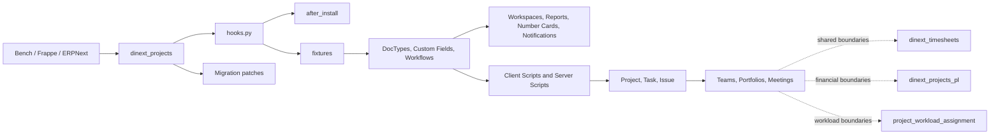

[English](README.md)

# Dinext Projects

`dinext_projects` — Frappe-приложение для проектного управления в экосистеме Dinext.
Оно устанавливается в существующий [Bench](https://github.com/frappe/bench)
с Frappe и ERPNext и добавляет модуль **Dinext Projects**: проектные команды,
роли, портфели, встречи, расширения Project/Task/Issue, workflow проектов,
Desk-workspaces, отчёты и уведомления.

Приложение является metadata-driven: большая часть поведения хранится в
экспортируемых Frappe fixtures (DocType, Custom Field, Client Script, Server
Script, Workflow и других метаданных). Python-код используется для контроллеров
DocType, установки и миграционных патчей.

## Содержание

- [Обзор и границы ответственности](#-обзор-и-границы-ответственности)
- [Возможности](#-возможности)
- [Установка](#-установка)
- [Использование](#-использование)
- [Технологии](#-технологии)
- [Конфигурация и fixtures](#-конфигурация-и-fixtures)
- [Требования](#-требования)
- [Разработка и сопровождение](#-разработка-и-сопровождение)
- [Документация](#-документация)
- [История изменений](#-история-изменений)
- [Структура репозитория](#-структура-репозитория)
- [Схема взаимодействия](#-схема-взаимодействия)
- [Лицензия](#-лицензия)

## 📖 Обзор и границы ответственности

Приложение сохраняет PM-контур: состав проектной команды, роли и портфели,
Meeting Notes и Assignments, расширения Project/Task/Issue, проектный workflow
и связанную Desk-аналитику.

В экосистеме Dinext функциональность разделена между приложениями:

| Приложение | Ответственность |
| --- | --- |
| `dinext_projects` | Project Team, Project Role, контакты и портфели, встречи, PM-расширения Project/Task/Issue, workflow Project, роль `Dinext_Worker`. |
| `dinext_timesheets` | Учёт времени: `Worker`, `Working Hours On Date`, UT/AFL, `Project.custom_working_hours_on_date`, workspace «Мои Таймшиты» и роли `Dinext_UT*`. |
| `dinext_projects_pl` | Ставки, ЦФО, схемы оплаты, P&L, финансовые поля Project/Task, роли `Dinext_Financier`, `Dinext_Fin_Dir`, `Dinext_Budget_Approver`, workspaces «Фин. Контроль» и «Аналитика», Number Card «Коммерческие проекты» и rate-control reports. |
| `project_workload_assignment` | Плановые трудозатраты, `Project Work Efforts*`, `Limit Control`, utilisation tables, соответствующие UI и отчёты. |
| `dinext_deputies` | Владеет DocType Permission для `User Delegate`. |

`hooks.py` задаёт обязательные для установки приложения `dinext_common`,
`doctype_permission` и `erpnext`. В эксплуатационной документации ранее
указывался порядок установки полного проектного контура:
`dinext_projects` → `dinext_projects_pl` → `doctype_permission` →
`dinext_timesheets` → `project_workload_assignment`. Перед установкой на новый
сайт сверяйте этот порядок с версиями и зависимостями конкретного окружения.

## ✨ Возможности

### Проекты, команды и справочники

- Расширения стандартных Project, Task и Issue через экспортируемые Custom Field,
  Client Script, Server Script и Property Setter.
- **Project Team Details**: проектные роли, участники, периоды действия, флаги
  согласования и уведомлений.
- **Project Role**, **Project Contact List** и **Project Portfolio** — роли,
  контакты и портфель проектов.
- **Meeting Notes** и **Assignments** — протоколы встреч, решения и поручения;
  автоматическое создание Task и ToDo настраивается Server Script.
- **Projects Email Mapping** и **Setting Table** — привязка входящей
  коммуникации к клиенту и проекту, а также настройки.
- **Issue Identification**, **Issue Estimations**, **Issue Participants**,
  **Project Issue Setting**, **Task Relation**, **Type Of Meeting**,
  **Business Area**, **Tax Id Code Type** и другие вспомогательные сущности.

### Согласования и автоматизации

- Project workflow и связанные Workflow State / Workflow Action Master
  экспортируются этим приложением.
- **Workflow Task** описывает задачи согласования: текущее и следующее
  состояние, действие, назначенного пользователя и доступные переходы.
- Уведомления **«Требуется согласование»** и **«Требуется исправление»**.
- Автозаполнение Issue по входящей коммуникации, создание Task из Meeting Notes,
  зеркалирование тегов Issue–Task и другие сценарии задаются Server Script в
  fixtures.

Workflow для Expense Claim, Purchase Invoice и Sales Invoice, а также разрешения
для Sales Invoice, Purchase Invoice и GL Entry относятся к
`dinext_projects_pl`, а не к этому приложению.

### Workspaces, отчёты и виджеты

- Workspaces: **«Мои проекты»**, **«Мои задачи»** и **«DiLike»**.
- Report Builder отчёт **«Статус по всем ком. проектам»**.
- 35 Number Cards для статусов проектов, задач, Issue, согласований и DiLike.
- Два Notification для ToDo присутствуют в module JSON, но в текущем состоянии
  выключены (`enabled: 0`).
- Workspaces, отчёт, Number Cards и Notifications поставляются как module JSON;
  они не входят в список `fixtures` из `hooks.py`.
- Локальных определений Dashboard Chart в репозитории нет.
- Workspace **«Аналитика»**, Number Card **«Коммерческие проекты»**, финансовые
  charts/cards и отчёты контроля ставок находятся в `dinext_projects_pl`;
  таймшитные и utilisation-отчёты — в `dinext_timesheets` и
  `project_workload_assignment`.

### Интеграции с соседними контурами

Поля `pt_worker`, `pt_cost_level` и `pt_category` у `Project Team Details`
сознательно принадлежат соседним приложениям: соответственно
`dinext_timesheets` и `dinext_projects_pl`. Миграционный патч этого приложения
снимает его владение этими полями, не удаляя колонки базы данных. При наличии
`dinext_timesheets` интерфейс может использовать `pt_worker` как основной выбор
участника и синхронизировать `Worker.wuser` с `pt_participant`.

## 🚀 Установка

Приложение устанавливается в существующий Bench с Frappe и, как правило,
ERPNext. Используйте фактический Git URL и ветку вашей поставки.

```bash
cd /path/to/your/bench
bench get-app <git-url> --branch <branch>
bench --site your-site.local install-app dinext_projects
bench --site your-site.local migrate
```

При изменениях JavaScript, CSS или метаданных, затрагивающих Desk, при
необходимости пересоберите assets и очистите кэш:

```bash
bench build --app dinext_projects
bench --site your-site.local clear-cache
```

Для локальной разработки приложение можно клонировать в
`apps/dinext_projects` и подключить как локальное app.

## 🛠️ Использование

После установки в Desk доступен модуль **Dinext Projects**.

- **Мои проекты** — проекты по типам, статусам и клиентам, справочники и отчёты.
- **Мои задачи** — задачи текущего пользователя.
- Workspace **«Аналитика»** (вложенный под «Мои проекты») появляется после
  установки `dinext_projects_pl`.
- Workflow-задачи выполняются в стандартных формах Frappe посредством workflow и
  Client/Server Script.
- Учёт времени и workspace **«Мои таймшиты»** появляются после установки
  `dinext_timesheets`.

## 📦 Технологии

- **Backend:** Python 3.10+, Frappe Framework и ERPNext.
- **Frontend:** Frappe Desk, JavaScript в Client Script и в файлах отчётов.
- **Данные:** MariaDB или PostgreSQL через Frappe ORM.
- **Сборка пакета:** `flit_core`.
- **Качество кода:** pre-commit, ruff, Prettier и ESLint.

## 🔧 Конфигурация и fixtures

Главная конфигурация находится в `dinext_projects/hooks.py`.

- `fixtures` экспортируют Role Profile, Project Type, Issue Priority, Custom
  HTML Block, Issue Type, Task Type, Custom Field, Property Setter, Client
  Script, Server Script, Web Page, роли, Custom DocPerm, Project workflow,
  Workflow State, Workflow Action Master и часть DocType Permission.
- Module JSON под `dinext_projects/dinext_projects/` поставляют custom DocType,
  workspaces, Report Builder отчёт, Number Cards и Notifications отдельно от
  fixture export.
- `after_install` очищает стандартные ERPNext значения Project Type и Issue
  Priority перед импортом значений приложения.
- Список required apps: `dinext_common`, `doctype_permission`, `erpnext`.
- На уровне app не включены глобальные JS/CSS, scheduler events, doc events или
  overrides: соответствующие примеры в `hooks.py` закомментированы.
- Переменные окружения и серверные параметры задаются стандартным механизмом
  Bench/Frappe; этот репозиторий не объявляет собственных переменных окружения.

После изменения объектов, управляемых Frappe (например, Custom Field, Client
Script, Server Script или Workflow), экспортируйте fixtures из Bench и добавьте
обновлённые JSON в коммит:

```bash
bench --site your-site.local export-fixtures
```

Изменения в UI без последующего экспорта fixtures создают расхождение между
сайтом и репозиторием.

## ✅ Требования

- [Bench](https://github.com/frappe/bench) с Frappe и ERPNext.
- Python **>= 3.10** (закреплено в `pyproject.toml`).
- Совместимые версии Frappe/ERPNext для используемой поставки Dinext.
- Для разработки JS/CSS: Node.js и yarn, используемые вашим Bench.
- Для локальных проверок: pre-commit.

## 🤝 Разработка и сопровождение

### Рабочий процесс

1. Создайте отдельную ветку.
2. Для любого изменения сначала пройдите обязательный OpenSpec lifecycle из
   [AGENTS.md](AGENTS.md).
3. Вносите изменения в код и metadata только в соответствии с готовыми задачами
   change.
4. При изменении metadata экспортируйте fixtures.
5. Запустите проверки и обновите README, если меняется его фактическое
   содержание.

### Локальные проверки

```bash
cd apps/dinext_projects
pre-commit install
pre-commit run --all-files
```

Настроенные hooks проверяют Python (`ruff` и форматирование), JavaScript
(`eslint`), JavaScript/Vue/SCSS (`prettier`), а также пробелы, merge conflict
маркеры, AST, JSON, TOML, YAML и debug-выражения.

### Где искать логику

- `fixtures/` — основная часть поведения и экспортируемых метаданных.
- `dinext_projects/doctype/` — JSON-описания и контроллеры custom DocType.
- `dinext_projects/report/` — в текущей версии единственный Report Builder JSON
  «Статус по всем ком. проектам»; Script Report при добавлении будет содержать
  Python для колонок/данных и JavaScript для фильтров.
- `dinext_projects/workspace/` — конфигурация Desk-workspaces.
- `dinext_projects/number_card/` — KPI-карточки; локальных определений
  Dashboard Chart нет.
- `dinext_projects/notification/` — ExampleCustomer08 уведомлений и их Python-контекст;
  текущие два Notification отключены.
- `install.py` — обработчик `after_install`.
- `patches/` — миграционные патчи.

Не используйте README как замену инженерному контракту: navigation stub
[AGENTS.md](AGENTS.md) ведёт к каноническим правилам Frappe и Dinext.

## 📄 Документация

- [AGENTS.md](AGENTS.md) — вход в central Dinext guidance и обязательный
  OpenSpec workflow.
- [Frappe Framework](https://frappeframework.com/docs) — документация платформы.
- [Bench](https://github.com/frappe/bench) — установка и управление окружением.

## 📝 История изменений

Краткая историческая сводка по commit history:

- Контуры были разделены: timesheets — в `dinext_timesheets`, финансы — в
  `dinext_projects_pl`, трудозатраты и utilisation — в
  `project_workload_assignment`; `dinext_projects` оставляет PM-функции и
  скорректированные fixture filters.
- Удалены устаревшие файлы и конфигурации, связанные с бюджетом проектов,
  риск-менеджментом (категории, уровни, воздействия, стратегии, приоритеты и
  вероятности), назначением рабочей нагрузки, а также устаревшие Server Script
  и Client Script.
- Дорабатывались task dashboard, Project-planning UI, P&L-отчёты и стили
  элементов бюджета; для действий P&L добавлялось выпадающее меню.
- Обновлялись роли и права, включая возврат `Dinext_Support_Dispatcher`,
  Custom Field, fixtures, notifications, workspace DiLike и метаданные модуля;
  менялись видимость полей и название модуля (Dinext Risk Management → Dinext
  Projects).
- Удалены неиспользуемые изображения, темы, настройки навигации, CSS и
  JS-библиотеки (включая Gantt, ECharts, Frappe DataTable и HyperList).

За полным журналом обращайтесь к истории Git конкретной ветки.

## 🗂️ Структура репозитория

```text
dinext_projects/
├── AGENTS.md                         # Инструкции для агентов
├── README.md                         # Этот документ
├── license.txt                       # Лицензия GPL-3
├── pyproject.toml                    # Метаданные пакета, Python и ruff
├── .pre-commit-config.yaml           # Локальные проверки
├── openspec/config.yaml              # Конфигурация OpenSpec
└── dinext_projects/
    ├── __init__.py                   # Версия приложения
    ├── hooks.py                      # App configuration, dependencies и fixtures
    ├── install.py                    # after_install hook
    ├── modules.txt                   # Имя Desk-модуля
    ├── patches.txt                   # Список миграционных патчей
    ├── patches/                      # Реализация миграций
    ├── fixtures/                     # Экспортированные Frappe metadata (JSON)
    ├── translations/ru.csv           # Русские переводы
    ├── public/                       # Public assets приложения
    ├── templates/                    # Frappe templates
    └── dinext_projects/
        ├── doctype/                  # Custom DocType: JSON, controllers, tests, JS
        ├── report/                   # Frappe reports
        ├── workspace/                # Мои проекты, Мои задачи, DiLike
        ├── number_card/              # KPI-карточки PM/Issue/DiLike
        └── notification/             # Notifications и Python-контекст
```

Соседние приложения предоставляют таймшитные DocType и workspace
«Мои таймшиты», финансовые P&L-объекты и планирование нагрузки; они не входят в
это дерево.

## 🔗 Схема взаимодействия



Bench загружает `hooks.py`; fixtures формируют Frappe metadata и сценарии Desk,
а `after_install` и миграционные патчи поддерживают корректное состояние сайта.
Смежные контуры остаются в отдельных приложениях и интегрируются через
согласованные Frappe-сущности.

## 📜 Лицензия

[GNU GPL v3](license.txt).
